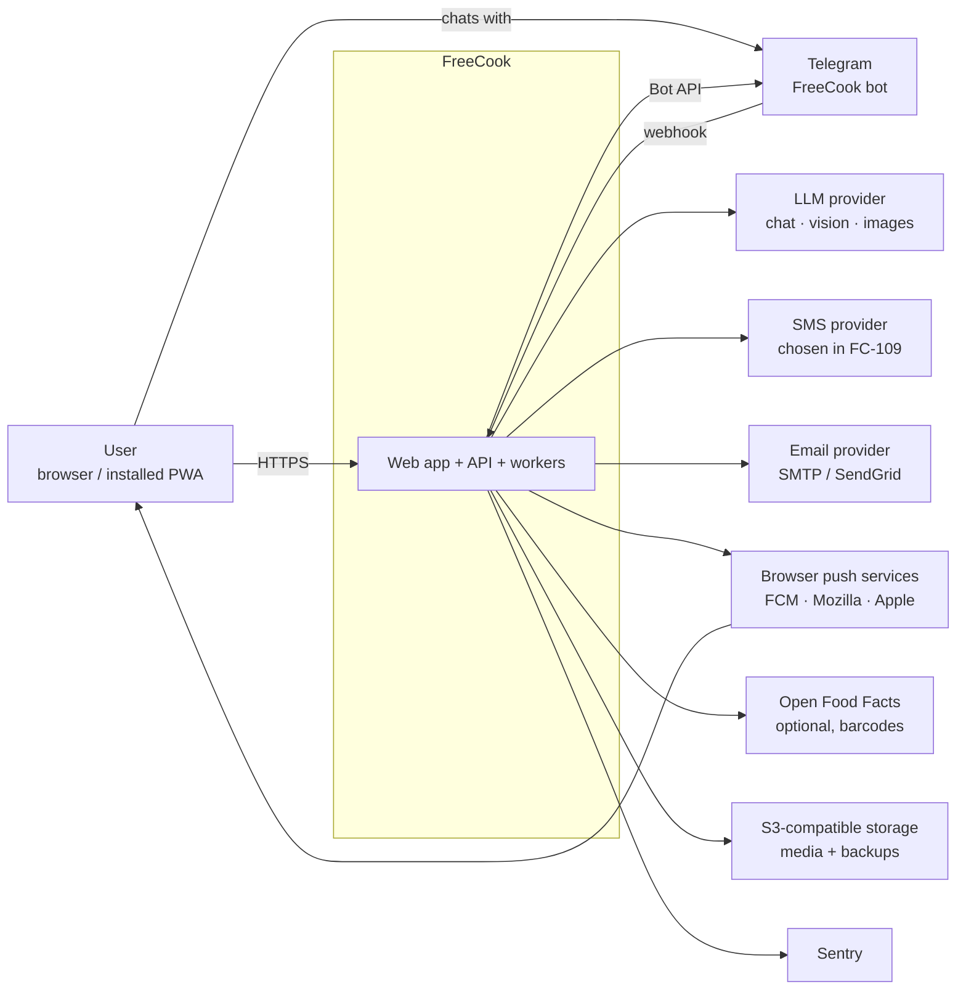
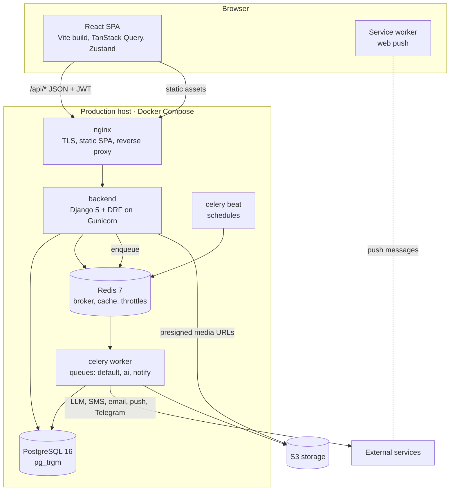
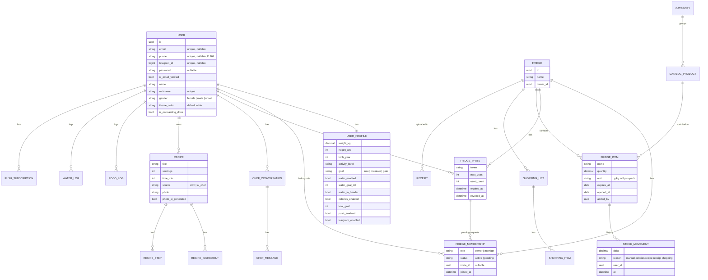
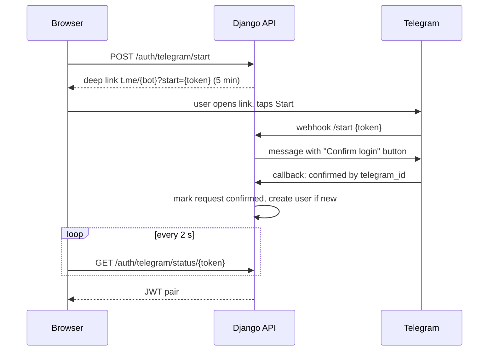
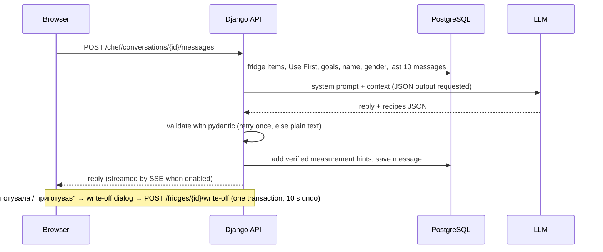
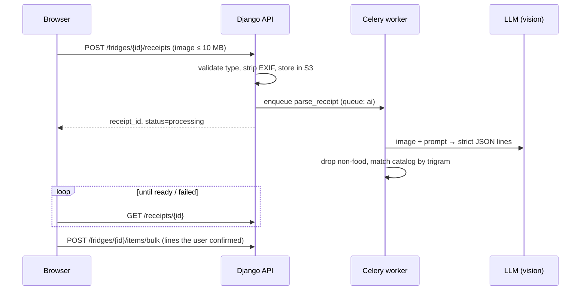
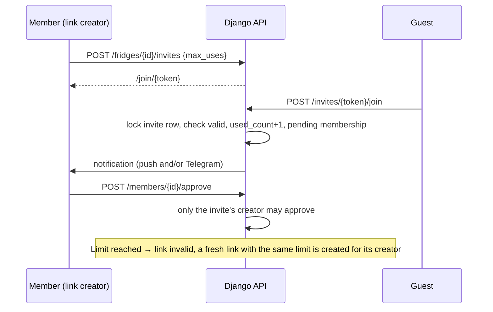
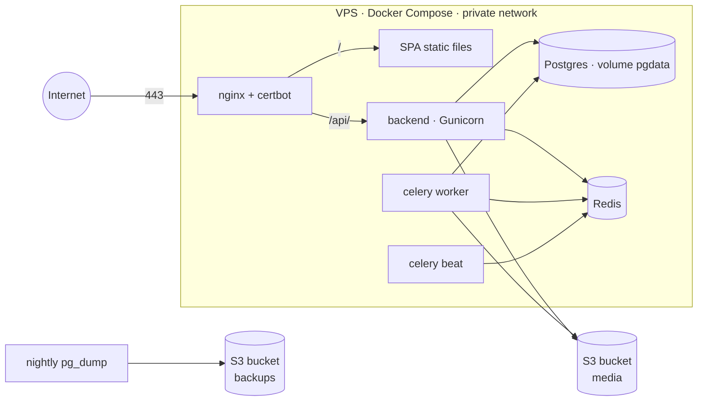
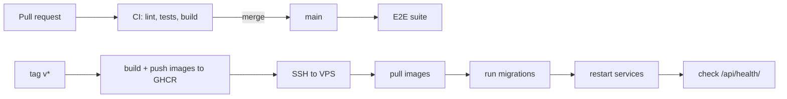

# FreeCook — Architecture and Infrastructure Design

Status: draft for review · Date: 2026-11-23 · Scope: web app v1 (tickets FC-001 … FC-910)

FreeCook is a single repository with a Django REST API, a React single-page app, and background workers, all run with Docker Compose. One VPS runs production behind Nginx. PostgreSQL holds all data, Redis queues background jobs, and an LLM provider powers the AI Chef, receipt recognition and recipe photos.

---

## 1. Goals and constraints

| Goal / constraint | What it means for the design |
| --- | --- |
| Small team (1–2 developers), ~20 weeks | One repo, one database, one deployable stack; no microservices |
| Ukrainian-only UI, mobile-first, desktop supported | React SPA, responsive layouts, PWA manifest for home-screen install |
| Shared refrigerators, several per user | Every fridge-scoped row carries `fridge_id`; one permission rule checks membership |
| AI features (chef, receipts, photos) | One AI client module, structured JSON output, slow work in Celery |
| Three login methods, two of them passwordless | Custom user model, one-time codes, Telegram bot login, JWT sessions |
| Reminders by browser push and Telegram, each optional | One notification service with two channels |
| Low running cost at launch | One VPS + S3-compatible storage + pay-per-use AI / SMS with spending limits |

Non-goals for v1: native mobile apps, real-time sockets, multiple languages, horizontal scaling.

---

## 2. System context



---

## 3. Containers (runtime components)



| Container | Image | Role | Tickets |
| --- | --- | --- | --- |
| `nginx` | nginx:alpine + built SPA | TLS, serves `frontend/dist`, proxies `/api/` and `/media/`, gzip, security headers | FC-904 |
| `backend` | python:3.12-slim | Django + DRF API, OpenAPI at `/api/docs/`, Telegram webhook | FC-002, FC-904 |
| `celery` | same image as backend | Background jobs: codes, AI, photos, notifications | FC-002, FC-404, FC-608 |
| `celery-beat` | same image as backend | Scheduled jobs (water reminders, cleanups) | FC-603 |
| `db` | postgres:16 | All application data | FC-004 |
| `redis` | redis:7 | Celery broker, cache, DRF throttle counters | FC-004 |
| `bot` (dev only) | same image as backend | Telegram polling, because localhost cannot receive webhooks | FC-105 |
| `mailpit` (dev only) | axllent/mailpit | Catches outgoing email in development | FC-004 |
| `frontend` (dev only) | node:20-alpine | Vite dev server with hot reload | FC-004 |

---

## 4. Repository layout

```
freecook/
  docker-compose.yml            # development
  docker-compose.prod.yml       # production
  .env.example                  # every variable, no secrets
  .github/workflows/            # ci.yml, deploy.yml
  docs/decisions/               # short decision records (e.g. sms-provider.md)
  nginx/nginx.conf
  scripts/backup.sh
  backend/
    Dockerfile  entrypoint.sh  manage.py  pyproject.toml  requirements.txt
    config/                     # settings/{base,dev,prod}.py, urls.py, celery.py
    core/
      ai/                       # client.py, images.py, prompts/*.md
      sms.py                    # pluggable SMS backend
      uploads.py                # file validation, EXIF stripping
    apps/
      accounts/                 # users, codes, login methods, linking, merge, deletion, export
      fridges/                  # fridges, memberships, invites, ownership transfer
      products/                 # catalog, fridge items, stock movements, units, barcode
      receipts/                 # receipt upload + recognition
      shopping/                 # shopping lists and items
      chef/                     # AI Chef conversations, context, hints
      nutrition/                # water and food logs, goal calculators
      recipes/                  # recipe journal, recipe nutrition, photos
      notifications/            # web push + Telegram channels
  frontend/
    Dockerfile  package.json  vite.config.ts
    public/                     # sw.js, manifest.webmanifest, icons
    src/
      api/  components/{ui,layout}/  features/<area>/  hooks/
      i18n/uk.json  routes/  store/  theme/  assets/
  e2e/                          # Playwright tests
```

---

## 5. Backend design

### 5.1 Layers

| Layer | Lives in | Rule |
| --- | --- | --- |
| Views / viewsets | `apps/*/views.py` | HTTP only: parse, check permission, call a service, serialize |
| Serializers | `apps/*/serializers.py` | Validation and shape of JSON |
| Services | `apps/*/services/*.py` | Business rules (stock changes, units, merge, ownership, invites); transactions live here |
| Models | `apps/*/models.py` | Data and constraints; no cross-app business logic |
| Tasks | `apps/*/tasks.py` | Celery entry points that call services |
| Integrations | `core/` | AI, SMS, uploads; swappable behind one interface each |

### 5.2 Django apps

| App | Owns | Key rules |
| --- | --- | --- |
| `accounts` | `User`, `UserProfile`, `OneTimeCode`, `TelegramLoginRequest` | A user has ≥ 1 of email / phone / telegram_id; codes hashed, 10 min, 5 attempts; merge registry; deletion and export |
| `fridges` | `Fridge`, `FridgeMembership`, `FridgeInvite` | `IsFridgeMember` on every fridge endpoint; any member creates links; only the link's creator approves its requests; owner leaves → earliest member becomes owner |
| `products` | `Category`, `CatalogProduct`, `FridgeItem`, `StockMovement`, `UnitConversion` | Quantity never < 0; every change writes a `StockMovement`; units converted by one service |
| `receipts` | `Receipt` | Upload → Celery → vision model → strict JSON → user confirms before anything is added |
| `shopping` | `ShoppingList`, `ShoppingItem` | Lists belong to the fridge; bought items can move to the fridge |
| `chef` | `ChefConversation`, `ChefMessage` | Fixed first message «Привітик! Що ти сьогодні хочеш поїсти?»; context = current fridge + Use First + goals + name + gender |
| `nutrition` | `WaterLog`, `FoodLog` | Goals by calculator or manual; reminders until goal reached, inside active hours |
| `recipes` | `Recipe`, `RecipeIngredient`, `RecipeStep` | Belongs to the user, not the fridge; AI photo generated on save |
| `notifications` | `PushSubscription`, `NotificationPreference` | Two channels, each optional; one failing channel never blocks the other |

### 5.3 Data model



### 5.4 API conventions

| Topic | Convention |
| --- | --- |
| Base path | `/api/`, no URL versioning (one client, deployed together) |
| Auth | `Authorization: Bearer <access JWT>`; access 15 min, refresh 30 days with rotation + blacklist |
| Token storage (recommended) | Access token in memory; refresh token in an `HttpOnly; Secure; SameSite=Strict` cookie scoped to `/api/auth/` |
| Fridge scope | `/api/fridges/{id}/…`; non-members get 404, not 403, so fridge ids cannot be probed |
| Pagination | Cursor pagination on lists that can grow (items, movements, messages, logs) |
| Errors | `{"code": "quantity_negative", "detail": "Ukrainian message", "fields": {...}}` |
| Rate limits | DRF throttles in Redis: codes 5/h per target and IP, AI Chef 30/h, receipts and photos per day |
| Schema | drf-spectacular OpenAPI; the frontend generates its TypeScript types from it |

Full endpoint list: appendix of the build guide and the ticket set.

---

## 6. Frontend design

| Concern | Choice |
| --- | --- |
| Build | React 18 + TypeScript + Vite; route-level code splitting |
| Server state | TanStack Query; every fridge query key includes `activeFridgeId`, so switching fridge refetches all fridge data |
| Client state | Zustand: session, active fridge, theme |
| Forms | react-hook-form + zod |
| Styling | Tailwind mapped to CSS variables; no raw hex in components |
| Theme | 17 named colors; tokens computed at runtime (bg 86 % to white, soft 60 %, line 50 %, accent darkened until contrast ≥ 4.8, ink = accent −30 %); written to `:root` |
| i18n | react-i18next, `uk.json` only; gendered strings use i18next context (`female` / `male` / neutral) from `user.gender` |
| Navigation | Mobile bottom nav: Холодильник, AI-кухар, Калорії (when enabled), Профіль. Desktop sidebar adds current-fridge card and Покупки |
| Freshness | Polling while a shared screen is open (lists 15 s); refetch on window focus |
| Push | Service worker `sw.js` + web app manifest; iPhone needs “Add to Home Screen” for push |
| Design source | Design canvas, version 3 mobile boards and “Стало” desktop boards |

---

## 7. Key flows

### 7.1 Telegram login (passwordless)



### 7.2 AI Chef message



### 7.3 Receipt to fridge



### 7.4 Invitation and approval



---

## 8. AI integration

| Use | Model type | Sync / async | Guardrails |
| --- | --- | --- | --- |
| AI Chef replies and recipes | Chat model, JSON output | Sync (SSE streaming optional) | 30 msgs/h per user; pydantic schema; one retry; Ukrainian only |
| Receipt recognition | Vision model | Async, queue `ai` | 10 MB limit; strict JSON; user confirms every line |
| Recipe photos | Image model | Async on save to journal | One photo per recipe; daily per-user limit; marked «Згенеровано AI» |
| Measurement hints («5 г цукру ≈ 1 чайна ложка») | None | Lookup table | Never generated by the model |

- One client (`core/ai/client.py`) wraps the provider: timeouts, retries with backoff, token and image usage logged per user and feature, so costs can be checked and limited.
- Prompts live in `core/ai/prompts/*.md` under version control, not in code strings.
- The provider (Gemini or OpenAI) is a settings choice; switching it should not change callers.

---

## 9. Background jobs

| Job | Trigger | Queue | Ticket |
| --- | --- | --- | --- |
| Send email code / reset link | On request | `notify` | FC-103, FC-107 |
| Send SMS code | On request | `notify` | FC-104 |
| Parse receipt | On upload | `ai` | FC-404 |
| Generate recipe photo | On save to journal | `ai` | FC-807 |
| Water reminder check | Hourly, inside active hours | `default` → `notify` | FC-603 |
| New join request / new owner notice | On event | `notify` | FC-702, FC-708 |
| Clean expired codes, Telegram login requests, old receipt images | Daily | `default` | FC-102, FC-105, FC-403 |
| Database backup | Nightly (host cron running `scripts/backup.sh`) | — | FC-904 |

Separate queues stop a burst of slow AI jobs from delaying login codes.

---

## 10. Infrastructure

### 10.1 Environments

| Environment | Where | How it runs | Data |
| --- | --- | --- | --- |
| Local | Developer machine | `docker compose up` (hot reload, Mailpit, console SMS, Telegram polling) | Seeded catalog, fake users |
| CI | GitHub Actions | Build images, lint, unit + API tests, E2E with mocked AI / SMS / Telegram | Throw-away database |
| Production | One VPS | `docker-compose.prod.yml` behind Nginx + Let's Encrypt | Real data, nightly backups |

A staging server is not in the ticket plan. Add one (same compose file, separate `.env`) before the first public launch if budget allows.

### 10.2 Production host



- Starting size: 2 vCPU, 4 GB RAM, 40 GB SSD. Most heavy work (AI) runs at the provider, so the host stays small.
- Only ports 80 and 443 are open; Postgres and Redis stay on the internal Docker network.
- Media (receipts, recipe photos) go to S3-compatible storage through django-storages and are served by presigned URLs. A single-host volume works for a first launch but makes backups and moves harder.
- Recommendation: delete receipt images 30 days after they are processed; the recognized lines are kept.

### 10.3 Build and deploy



- Images are tagged with the git tag; rollback = deploy the previous tag (migrations must stay backward compatible for one release).
- Telegram webhook is set to the production URL on deploy (FC-905).

### 10.4 Configuration

All settings come from environment variables; `.env.example` lists them without values.

| Group | Variables |
| --- | --- |
| Django | `DJANGO_SECRET_KEY`, `DJANGO_ALLOWED_HOSTS`, `FRONTEND_URL`, `DEBUG` |
| Database / cache | `DATABASE_URL`, `REDIS_URL` |
| Auth | `JWT_SIGNING_KEY`, `TELEGRAM_BOT_TOKEN`, `TELEGRAM_BOT_USERNAME`, `TELEGRAM_WEBHOOK_SECRET` |
| Messaging | `EMAIL_URL` / SMTP settings, `DEFAULT_FROM_EMAIL`, `SMS_BACKEND`, provider keys (FC-109) |
| AI | `AI_PROVIDER`, `AI_API_KEY`, `AI_CHAT_MODEL`, `AI_VISION_MODEL`, `AI_IMAGE_MODEL`, daily limits |
| Push | `VAPID_PUBLIC_KEY`, `VAPID_PRIVATE_KEY`, `VAPID_SUBJECT` |
| Storage | `S3_ENDPOINT`, `S3_BUCKET_MEDIA`, `S3_BUCKET_BACKUPS`, `S3_ACCESS_KEY`, `S3_SECRET_KEY` |
| Monitoring | `SENTRY_DSN_BACKEND`, `VITE_SENTRY_DSN` |
| Frontend | `VITE_API_URL`, `VITE_VAPID_PUBLIC_KEY` |

---

## 11. Security and privacy

| Area | Measure |
| --- | --- |
| Access control | `IsFridgeMember` on every fridge endpoint; owner-only and creator-only actions checked in services; one test per viewset (FC-902) |
| Auth | Hashed one-time codes, attempt limits, resend cooldown; refresh rotation + blacklist; password reset links valid 1 h, once; no email enumeration |
| Abuse and cost | Throttles on codes (SMS pumping), AI Chef, receipts, photos; provider spending limits (FC-906) |
| Transport and headers | HTTPS only, HSTS, CSP, secure cookies, CORS limited to the frontend origin |
| Uploads | Type sniffing, 10 MB cap, EXIF stripped, private bucket, presigned URLs |
| Secrets | Only in the server `.env`; never in git, logs or images |
| Personal data | Phone numbers, weight and food logs are personal and health-related: export and deletion (FC-907), privacy policy (FC-906), backups encrypted at rest |
| Admin | Django admin behind IP allow-list or 2FA |
| Dependencies | `pip-audit` and `npm audit` in CI |

---

## 12. Observability

- Errors: Sentry for backend, Celery and frontend, with release = git tag.
- Health: `/api/health/` checks database and Redis; an external uptime check calls it every minute.
- Logs: JSON to stdout, collected by Docker with rotation; no codes, tokens or message contents logged.
- Usage: AI tokens / images and SMS counts per day per feature, to watch cost against the limits.

---

## 13. Scaling path

The first version fits one host. Steps, in the order they are likely to be needed:

1. Move Postgres to a managed database with automatic backups.
2. Run more Celery workers, with the `ai` queue on its own worker.
3. Run several backend containers behind Nginx (the app is stateless; sessions are JWT, files are in S3).
4. Replace polling with server-sent events or Django Channels for shared lists.
5. Add a CDN in front of the SPA and media.

---

## 14. Decisions

| # | Decision | Reason |
| --- | --- | --- |
| D1 | One repo, one Django project, one SPA | Small team, features are tightly linked |
| D2 | PostgreSQL with `pg_trgm` for product search | Fast Ukrainian prefix + fuzzy search without a search server |
| D3 | Celery + Redis for slow and scheduled work | AI, SMS and reminders must not block requests |
| D4 | JWT (access in memory, refresh in HttpOnly cookie) | Works for SPA and later mobile apps; refresh not readable by scripts |
| D5 | Polling instead of websockets in v1 | Simpler; 15 s freshness is enough for shared lists |
| D6 | One AI client behind settings | Provider can change without touching features |
| D7 | Measurement hints from a verified table, never from the LLM | Numbers must be correct |
| D8 | Ukrainian only, gendered strings from the profile's gender | Product decision; correct grammar for «Я приготувала / приготував» |
| D9 | Recipes belong to users; lists and products belong to fridges | Matches how people share fridges but keep cookbooks |
| D10 | Only the link's creator approves its join requests | Product decision |
| D11 | Owner leaves → earliest member becomes owner | Product decision |
| D12 | Reminders through web push and Telegram, each optional | Push alone does not reach iPhone users without home-screen install |

## 15. Open items

| Item | Owner | Ticket |
| --- | --- | --- |
| SMS provider and monthly budget | Team discussion | FC-109 |
| Barcode scanning (in design, not in spec) | Product | FC-407, FC-408 (`optional`) |
| Staging server before public launch | Team | Not ticketed |
| AI provider and models (Gemini vs OpenAI) | Team | FC-404 |
